# Практическая работа № 3. Реализация приложения Electron

## Задание 1. Подготовка окружения и инициализация проекта

Работа выполнена на Windows 10. Использовались Visual Studio Code,
Git, Node.js и npm.

Версии инструментов:

| Инструмент | Версия |
|---|---|
| Node.js в среде разработки | 24.16.0 |
| npm | 11.13.0 |
| Electron | 45.0.0 |
| electron-builder | 26.15.3 |


Проект создан в каталоге electron-file-explorer.

Для инициализации и установки Electron выполнены команды:

```bat
npm init -y
npm install --save-dev electron
```

В package.json указаны название, версия, описание, автор и точка
входа main.js. Для запуска определён скрипт start, для сборки —
скрипт dist.

```json
"scripts": {
  "start": "electron .",
  "dist": "electron-builder --win nsis"
}
```

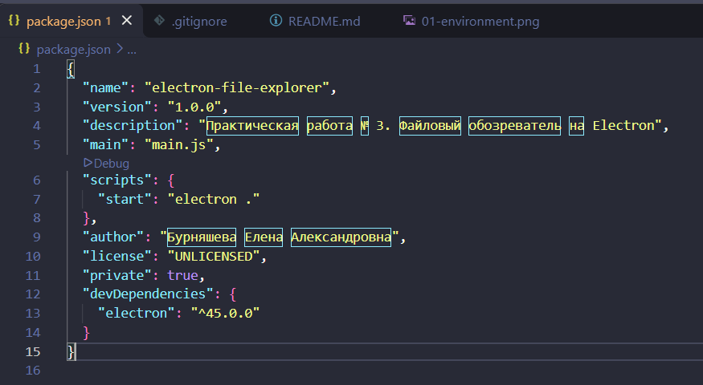

Исходный код размещается в репозитории:

https://github.com/burning-helen/crossplatform-practice-03

В .gitignore исключены node_modules/, dist/ и файлы журналов.
Файлы package.json и package-lock.json сохраняются в репозитории.

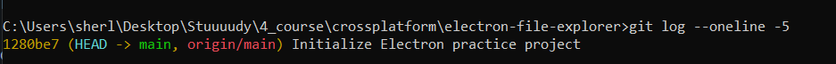

## Задание 2. Минимальное приложение

### Структура

| Файл | Назначение |
|---|---|
| main.js | Главный процесс: создание окна, меню и обработка системных операций |
| preload.js | Ограниченный мост между интерфейсом и главным процессом |
| renderer.js | Обработка действий пользователя и обновление DOM |
| index.html | Разметка интерфейса |
| styles.css | Оформление интерфейса |
| package.json | Метаданные, зависимости и команды проекта |

Приложение создаёт окно размером 1000 × 700 пикселей.
Минимальный размер окна — 700 × 500 пикселей.

Интерфейс загружается из локального index.html через loadFile.
На странице размещены ФИО, группа, номер варианта, кнопка чтения
каталога, строка состояния и список результатов.

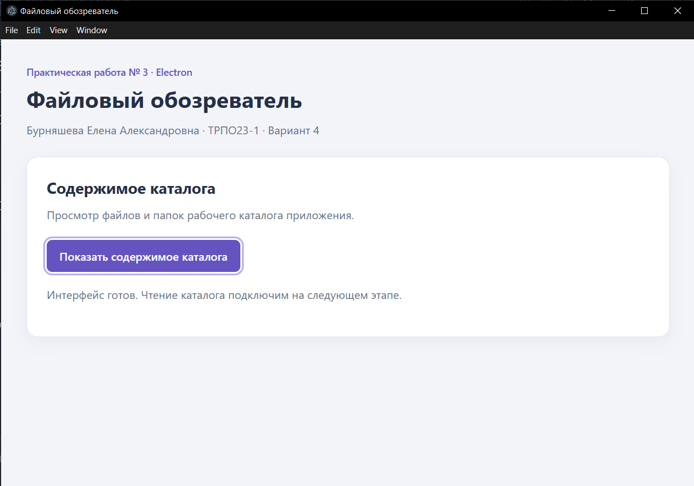

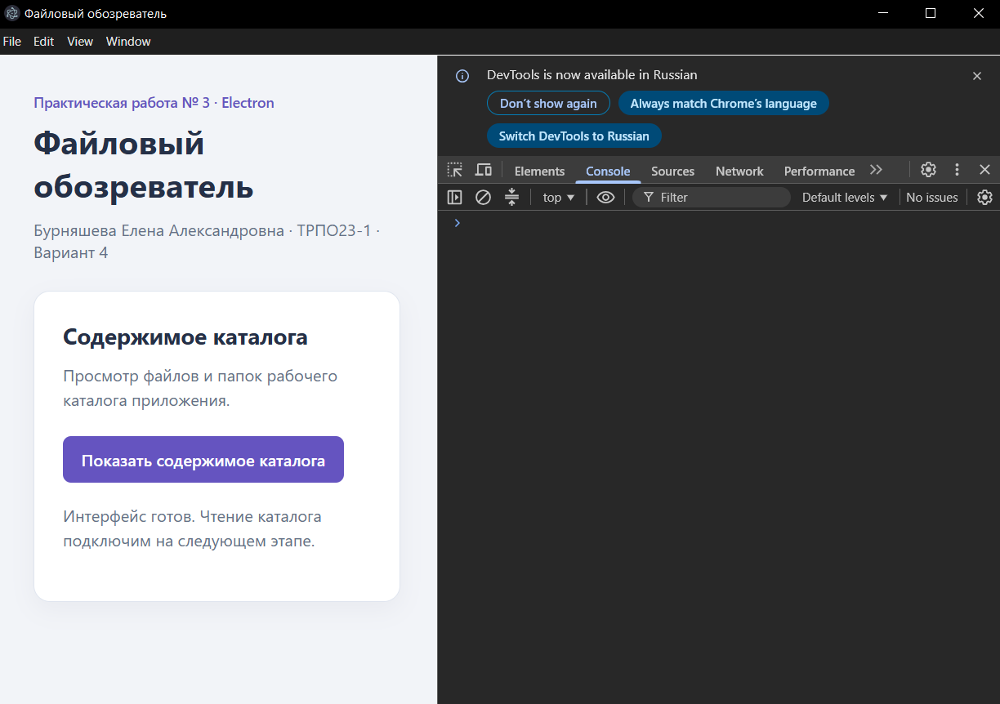

### Жизненный цикл

app.whenReady() возвращает Promise, который разрешается после
инициализации Electron. После этого создаются окно и главное меню.

Событие window-all-closed используется для завершения приложения
после закрытия всех окон на платформах, отличных от macOS.

На macOS приложение может оставаться запущенным без открытых окон.
При событии activate проверяется количество окон и при необходимости
создаётся новое.

## Задание 3. Preload и IPC: чтение каталога

### Разделение ответственности

Файловая операция выполняется в главном процессе.
Процесс отрисовки не обращается к модулю fs напрямую.

Последовательность взаимодействия:

1. Пользователь нажимает кнопку.
2. renderer.js вызывает window.api.listDir('.').
3. preload.js отправляет запрос ipcRenderer.invoke('list-dir', dir).
4. main.js обрабатывает его через ipcMain.handle.
5. fs.readdir читает рабочий каталог.
6. Результат возвращается в renderer.js и отображается в списке.

### Настройки изоляции

В BrowserWindow явно заданы:

```javascript
webPreferences: {
  preload: path.join(__dirname, 'preload.js'),
  contextIsolation: true,
  nodeIntegration: false,
  sandbox: true
}
```

nodeIntegration: false отключает прямое предоставление Node.js
коду страницы.

contextIsolation: true разделяет JavaScript-контексты preload
и веб-страницы.

sandbox: true включает песочницу процесса отрисовки.

Вместо предоставления странице произвольного системного API
используется ограниченный мост contextBridge.

### Мост preload

```javascript
contextBridge.exposeInMainWorld('api', {
  listDir: (dir) => ipcRenderer.invoke('list-dir', dir),

  onRefreshDirectory: (callback) => {
    if (typeof callback !== 'function') {
      throw new TypeError('Обработчик должен быть функцией.');
    }

    const listener = () => {
      callback();
    };

    ipcRenderer.on('refresh-directory', listener);

    return () => {
      ipcRenderer.removeListener('refresh-directory', listener);
    };
  }
});
```

Метод listDir выполняет запрос с ответом.
Метод onRefreshDirectory подписывает интерфейс на команду меню
и возвращает функцию удаления подписки.

Объект IPC-события и весь ipcRenderer в страницу не передаются.

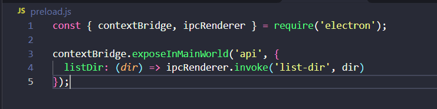

### Чтение каталога в главном процессе

Рабочий каталог фиксируется при запуске:

```javascript
const workingDirectory = process.cwd();
```

Обработчик проверяет, что запрос поступил от главного фрейма
локального окна приложения. Допустимым аргументом является
только строка ".".

Чтение выполняется асинхронно:

```javascript
const entries = await fs.readdir(workingDirectory, {
  withFileTypes: true
});
```

Результат преобразуется в массив объектов:

```javascript
{
  name: entry.name,
  isDir: entry.isDirectory()
}
```

Сначала выводятся каталоги, затем остальные записи.
Внутри групп применяется сортировка по имени.

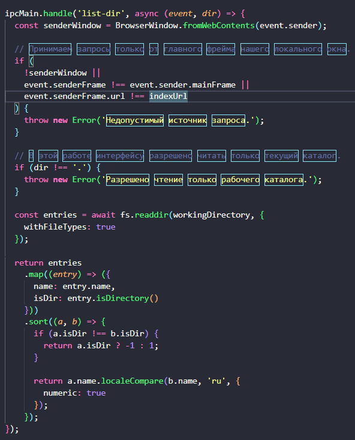

### Обновление интерфейса

Функция refreshDirectory() запрашивает данные, очищает предыдущий
список и создаёт новые элементы DOM.

Имена записываются через textContent, поэтому не интерпретируются
как HTML-разметка.

Для каталогов используется отдельный CSS-класс directory.
Во время запроса кнопка блокируется. Ошибки отображаются
в строке состояния, после завершения запроса кнопка разблокируется.

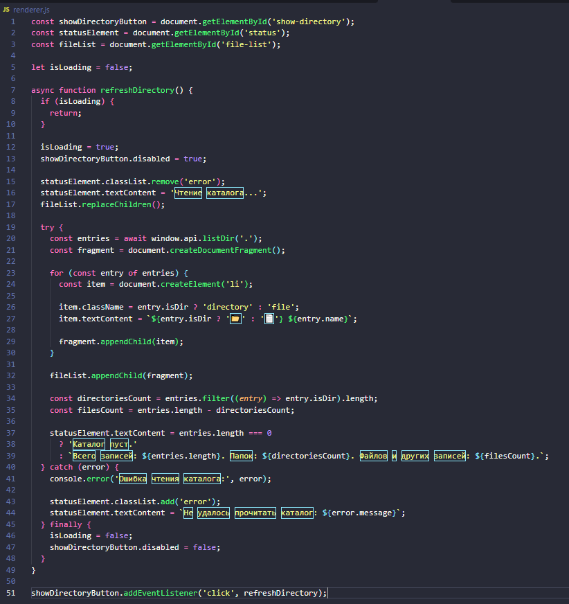

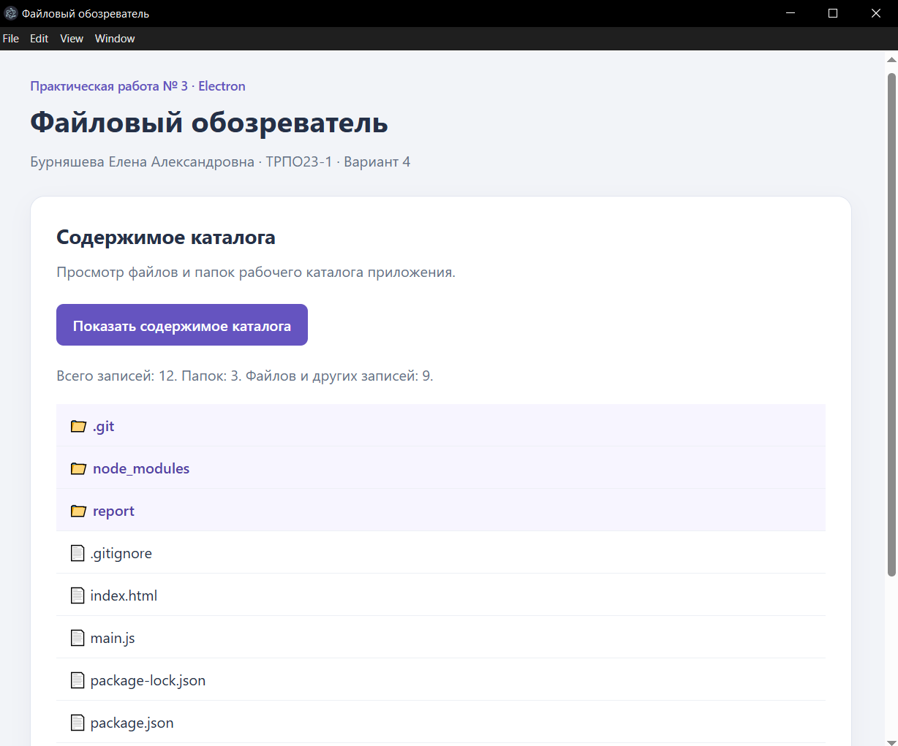

### Связь с переносимостью и POSIX

Модуль fs Node.js предоставляет единый интерфейс работы
с файловой системой на поддерживаемых платформах.

В приложении используется fs.readdir, поэтому прикладной код
не содержит отдельных реализаций перечисления файлов
через WinAPI и системные вызовы Unix.

Это иллюстрирует идею переносимого системного API, связанную
с POSIX-совместимым программированием. При этом использование
Node.js не делает Windows POSIX-совместимой системой
и не устраняет все различия файловых систем.

Системные различия скрываются реализацией среды выполнения,
но права доступа, правила имён и поведение файловой системы
необходимо учитывать при переносе.

## Задание 4. Главное меню — вариант 4

### Реализованная функция

Добавлено главное меню приложения:

- Файл:
  - Обновить список;
  - Выйти.
- Вид:
  - Инструменты разработчика;
  - Обычный масштаб;
  - Увеличить;
  - Уменьшить.

Меню создаётся через Menu.buildFromTemplate и устанавливается
через Menu.setApplicationMenu.

Для macOS дополнительно предусмотрено стандартное меню приложения.

### Обработка команды обновления

Пункт «Обновить список» имеет сочетание CmdOrCtrl+R.

Его обработчик выбирает активное окно либо первое доступное окно
и отправляет сообщение:

```javascript
targetWindow.webContents.send('refresh-directory');
```

Preload принимает сообщение и вызывает зарегистрированный callback.
В renderer.js подписка организована так:

```javascript
const unsubscribeRefresh = window.api.onRefreshDirectory(() => {
  refreshDirectory();
});
```

Таким образом, кнопка и главное меню используют общую функцию
refreshDirectory(). Меню инициирует повторное чтение каталога,
а не перезагрузку HTML-страницы.

При выгрузке страницы подписка удаляется:

```javascript
window.addEventListener('beforeunload', () => {
  unsubscribeRefresh();
}, { once: true });
```

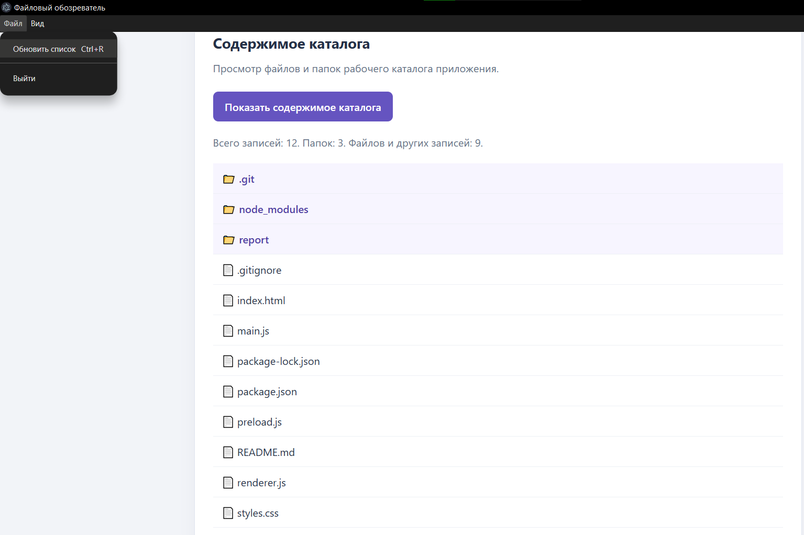

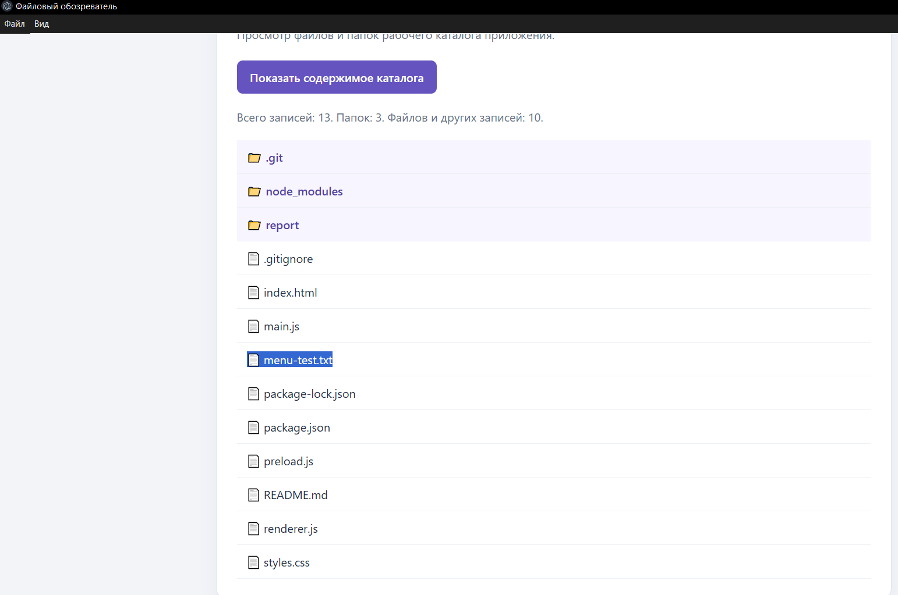

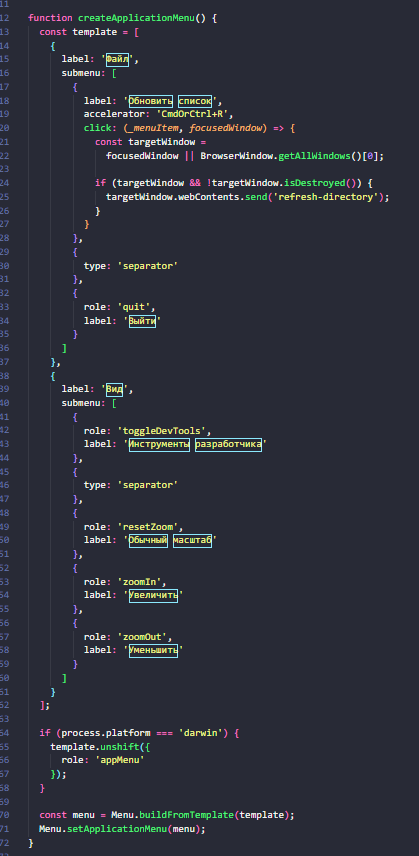

## Источники

- Electron. Process Model:
  https://www.electronjs.org/docs/latest/tutorial/process-model
- Electron. Inter-Process Communication:
  https://www.electronjs.org/docs/latest/tutorial/ipc
- Electron. Context Isolation:
  https://www.electronjs.org/docs/latest/tutorial/context-isolation
- Electron. Menu:
  https://www.electronjs.org/docs/latest/api/menu
- Node.js. File System:
  https://nodejs.org/api/fs.html

Дата обращения: 22.10.2026.