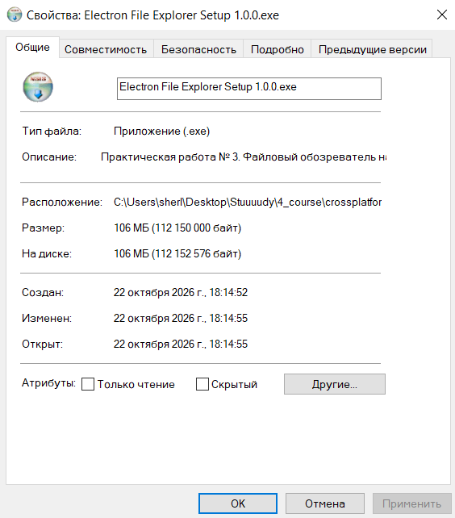
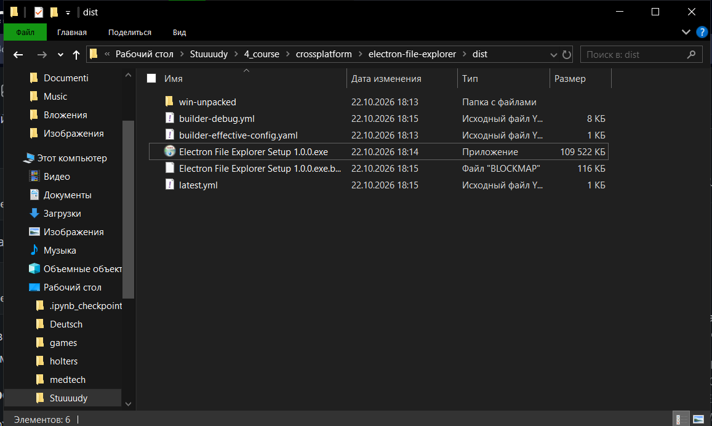
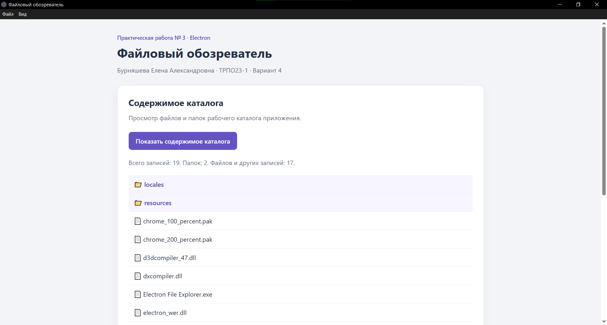

# Задание 5. Сборка дистрибутива

## Инструменты и параметры сборки

Сборка выполнена на Windows 10 для архитектуры x64.

Использованные инструменты:

- Node.js: 24.16.0 — среда разработки.
- npm: 11.13.0.
- Electron: 45.0.0.
- electron-builder: 26.15.3.

Версия Node.js, установленная на компьютере, относится к среде
разработки. Версия Node.js, встроенная в Electron, определяется
отдельно через process.versions.node.

Для упаковки выбран формат NSIS — установщик Windows.

Команда сборки:

```bat
npm run dist
```

## Результат

В каталоге dist сформирован установщик:

Electron File Explorer Setup 1.0.0.exe

Размер установщика: 112 150 000 байт.

В окне свойств Windows размер отображается как приблизительно 106 МБ.
Измерялся размер самого установщика, а не размер установленного
приложения и не значение «На диске».





## Проверка упакованного приложения

Приложение запущено из каталога dist/win-unpacked.
Проверены чтение рабочего каталога и обновление списка
через пункт главного меню «Обновить список».
Обе функции работают корректно.



## Вывод

Полученный установщик занимает 112 150 000 байт, несмотря
на небольшой объём прикладного кода. Это объясняется тем,
что приложение распространяется вместе с инфраструктурой Electron,
включающей Chromium и Node.js.

По сравнению с небольшим нативным приложением, использующим
системные библиотеки интерфейса, такой способ поставки создаёт
существенные накладные расходы. Численное сравнение с нативным
аналогом в данной работе не выполнялось: отдельный нативный
дистрибутив не собирался и не измерялся.

Electron целесообразен для приложений со сложным веб-интерфейсом,
когда важны повторное использование веб-технологий и общая
кодовая база для нескольких настольных платформ.

Для небольших утилит с жёсткими ограничениями по размеру поставки
следует рассмотреть нативную разработку или фреймворки,
использующие системный WebView. Окончательный выбор требует
проверки доступных API, системных зависимостей и стоимости
сопровождения.

## Источники

- Electron — официальный репозиторий:
  https://github.com/electron/electron
- electron-builder — документация:
  https://www.electron.build/docs/
- electron-builder — NSIS:
  https://www.electron.build/docs/nsis/

Дата обращения: 22.10.2026.